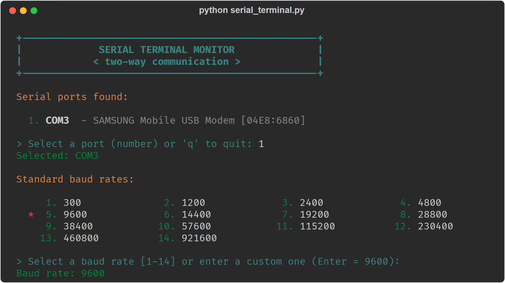
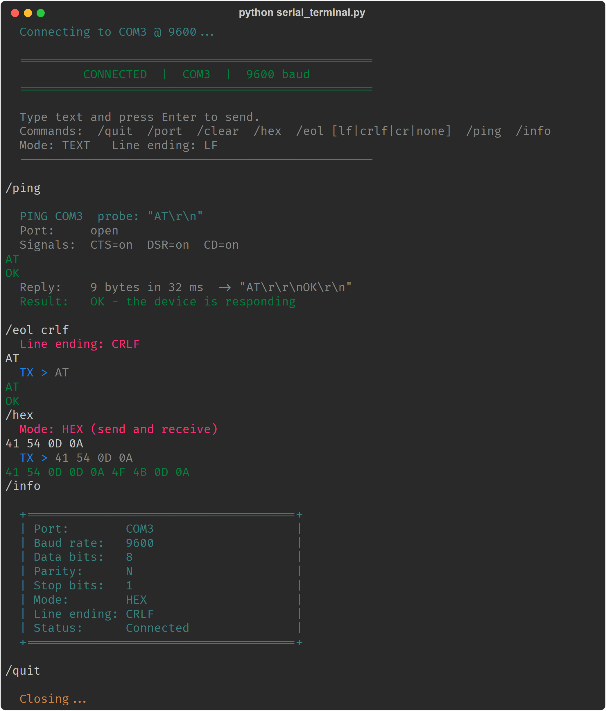
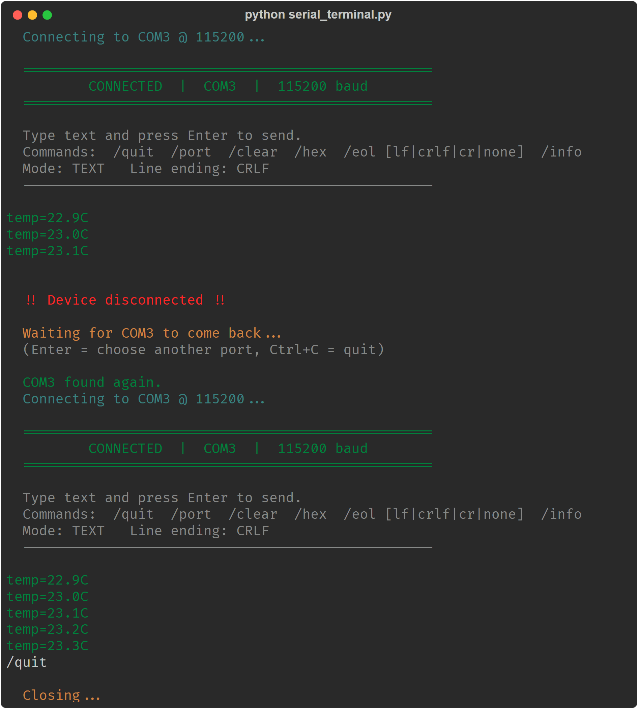

# Python Serial Monitor

A lightweight, two-way serial terminal for the command line. Pick a port, pick a baud rate, and talk to your
Arduino, ESP32, GSM/USB modem or any other serial device — in plain text or raw hex.

Single file, one dependency ([pyserial](https://pypi.org/project/pyserial/)), works on Windows, Linux and macOS.



## Features

- **Live port detection** — a two-step wizard (port, then baud rate) with a port table showing descriptions and VID:PID. It refreshes on its own while you choose; newly plugged devices get a `new` badge and removed ones are announced.
- **Two-way communication** — every line is timestamped and marked `TX ▶` (sent), `RX ◀` (received) or `SYS` (monitor messages).
- **Status bar** — connection state, port, baud rate, mode, line ending, RX/TX byte counters and uptime stay on the top row; the command bar and input line stay at the bottom while data scrolls in between.
- **Light and dark theme** — `/theme` switches between them; the choice is remembered.
- **Session logging** — `/log` saves everything shown to a timestamped file.
- **Text and HEX modes** — `/hex` switches both sending and receiving to hex bytes, shown as a hex dump with an ASCII column and the reply time, for binary protocols.
- **Configurable line ending** — send `LF`, `CRLF`, `CR` or nothing after each line (`/eol`).
- **Connectivity test** — `/ping` sends a probe and shows a report card: whether the device replies, how fast, and the modem line signals.
- **Automatic reconnect** — if the device is unplugged, the monitor waits for the same port to return and reconnects at the same baud rate, on the same screen.
- **Correct UTF-8 handling** — multi-byte characters (e.g. Cyrillic) are decoded correctly even when split across reads.
- **Clean exit** — `Ctrl+C` exits gracefully from any screen.

## Screenshots

**Talking to a USB modem** — a `/ping` connectivity test, `AT` → `OK` in text mode, the same exchange in HEX mode, then `/info`:



**Automatic reconnect** — the device is unplugged mid-session and the monitor reconnects by itself once it is back
(shown with a simulated temperature sensor):



## Requirements

- Python 3.7+
- pyserial

## Installation

```bash
git clone https://github.com/Flame-Petrov/Python-Serial-Monitor.git
cd Python-Serial-Monitor
python -m pip install -r requirements.txt
```

## Usage

```bash
python serial_terminal.py
```

1. **Choose a port** — type its number from the list (`q` to quit). If no device is connected, the monitor scans every 2 seconds until one appears.
2. **Choose a baud rate** — type a number from the list (1–14), type any custom value, or just press `Enter` for 9600.
3. **Communicate** — type text and press `Enter` to send it. Incoming data appears as it arrives.

### Commands

| Command | Description |
|---|---|
| `/quit` | Close the connection and exit |
| `/port` | Close the connection and go back to the port list (the current baud rate becomes the `Enter` default) |
| `/baud` | Show the current baud rate |
| `/baud <rate>` | Change the baud rate without reconnecting (also used for automatic reconnects and as the next `Enter` default) |
| `/clear` | Clear the screen and redraw the connection header with the commands |
| `/hex` | Toggle HEX mode for sending **and** receiving |
| `/eol` | Show the current line ending |
| `/eol lf\|crlf\|cr\|none` | Set the line ending appended to sent text |
| `/ping` | Test connectivity: send `AT` and report whether and how fast the device replies |
| `/ping <probe>` | Same, with your own probe (text + line ending, or hex bytes in HEX mode) |
| `/info` | Show port settings, mode and connection status |
| `/log` | Start or stop saving the session to `serial_<port>_<date>_<time>.log` in the current folder |
| `/theme` | Switch between the dark and light theme (also works at the port prompt) |

### Session screen

- Received data is shown line by line. CR, LF and CRLF all end a line, and empty lines are skipped.
  A line without an ending (e.g. a `> ` prompt) appears after 150 ms of silence.
- In HEX mode the bytes received until a 150 ms pause (or 256 bytes) are shown as one hex dump.
- `ERROR`, `+CME ERROR` and `+CMS ERROR` replies are shown in red.
- When the output is redirected (not a terminal), the monitor prints plain lines without the status bar.

### Themes

The dark theme uses your terminal's own colours and background. The light theme paints its own
background with 24-bit colours, which Windows Terminal and all modern terminals support. The choice is saved
in `~/.serial_terminal.json`.

### Connectivity test

`/ping` checks that the device is really there and answering:

```text
  ┌─ PING · COM3 ──────────────────────────────────────────────────────────┐
  │  Probe    "AT\r\n"                                                     │
  │  Port     ● open                                                       │
  │  Signals  ● CTS   ● DSR   ● CD   ○ RI                                  │
  │  Reply    9 bytes in 32 ms  → "AT\r\r\nOK\r\n"                         │
  │  Latency  █░░░░░░░░░░░░░░░░░░░  32 / 2000 ms                           │
  ├────────────────────────────────────────────────────────────────────────┤
  │   OK   the device is responding                                        │
  └────────────────────────────────────────────────────────────────────────┘
```

- **Port** — whether the serial port is still open.
- **Signals** — modem control lines (CTS, DSR, CD, RI); `●` is on, `○` is off. Many USB adapters and boards report them all as off; that is normal.
- **Reply** — the first reply within 2 seconds, its size, latency and contents with control characters made visible.
- **Latency** — the reply time against the 2-second limit.

The default probe `AT` suits modems. Other devices only answer commands they understand, so give your own probe:

```text
/ping hello            text mode: sends "hello" + the current line ending
/ping 01 03 00 00 00 01 84 0A   hex mode: sends these exact bytes
```

`NO REPLY` means the port works but the device did not answer that probe — check the baud rate, line ending and
the probe itself.

### HEX mode

In HEX mode, type bytes in any of these formats:

```text
41 54 0D 0A
0x41,0x42,0x0D
41540D0A
0xF 0x1          (single digits are padded: 0F 01)
```

Sent and received bytes are shown as a hex dump: offset, 16 bytes per row (8 on terminals narrower than
105 columns) and an ASCII column. Control bytes (CR, LF, NUL…) are dimmed so the payload stands out. A reply
to a HEX send shows how long the device took (`+31 ms`), and the command bar suggests `/ping` with the
last bytes you sent.

```text
                    offset  00 01 02 03 04 05 06 07  08 09 0A 0B 0C 0D 0E 0F   ascii
  12:05:30.010  TX ▶  0000  41 54 0D 0A                                       │AT..            │
  12:05:30.041  RX ◀  0000  41 54 0D 0D 0A 4F 4B 0D  0A                       │AT...OK..       │  +31 ms
```

### Line endings

The default is `LF` (`\n`), which suits most Arduino sketches. Many devices need something else:

| Device | Setting |
|---|---|
| Arduino / ESP32 (`Serial.readStringUntil('\n')`) | `/eol lf` |
| GSM / USB modems (AT commands) | `/eol crlf` |
| Some older terminals and instruments | `/eol cr` |
| Binary protocols | `/hex` (no line ending is added) |

If the device never answers, the line ending is the first thing to check.

### Automatic reconnect

When the device is unplugged, the monitor shows a red `DEVICE DISCONNECTED` banner immediately. The status
bar switches to `DISCONNECTED` with the reconnect attempt, and a spinner shows how long the device has been
gone. When the same port reappears, the monitor reconnects with the same baud rate, mode and line ending and
shows a green `RECONNECTED` banner with the time offline; the session continues on the same screen.

- Press `Enter` while waiting to go back to the port list instead.
- Press `Ctrl+C` to exit.

## Connection settings

8 data bits, no parity, 1 stop bit (8N1), no flow control. Baud rate is chosen at startup.

## Troubleshooting

**`Error importing pyserial`** — pyserial is not installed for the Python you are running, or a file named
`serial.py` in the same folder shadows the library. Rename that file and run:

```bash
python -m pip install pyserial
```

**`Connection failed`** — the port is open in another program (Arduino IDE serial monitor,
PuTTY, another terminal). Close it and try again. On Linux, add your user to the `dialout` group.

**Garbled text** — the baud rate does not match the device. Reconnect with the correct one.

**Colour codes like `←[92m` instead of colours** — use Windows Terminal or Windows 10/11; very old consoles do not
support ANSI colours.

## Project structure

```text
serial_terminal.py     the application
requirements.txt       dependencies
docs/screenshots/      images used in this README
```
